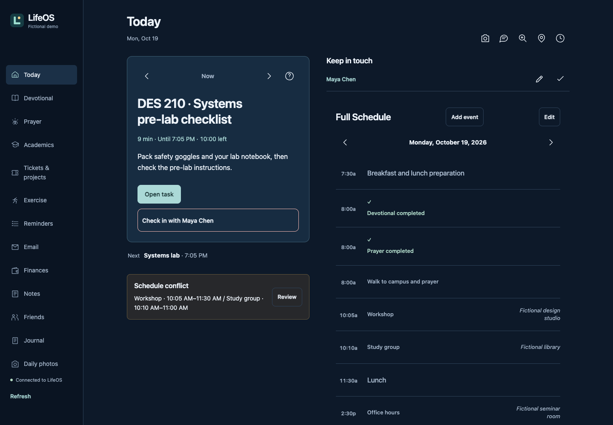
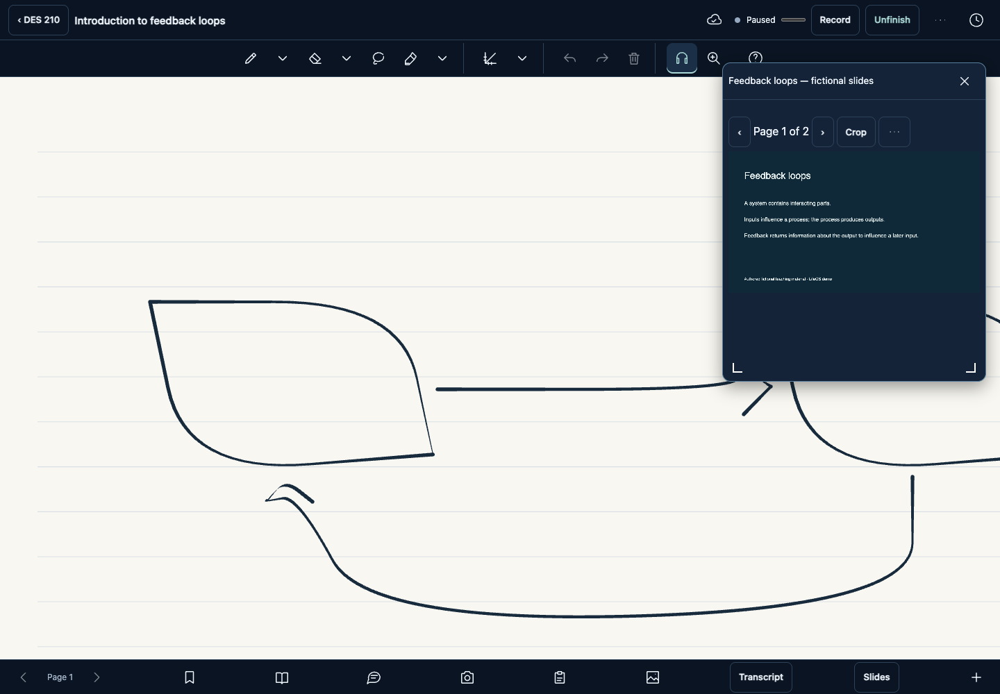
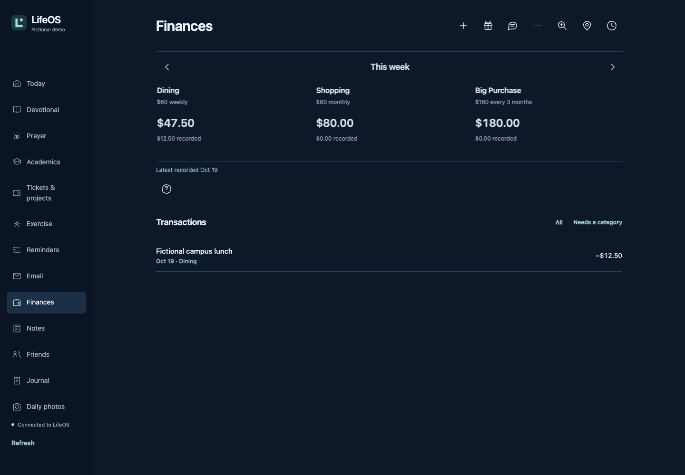
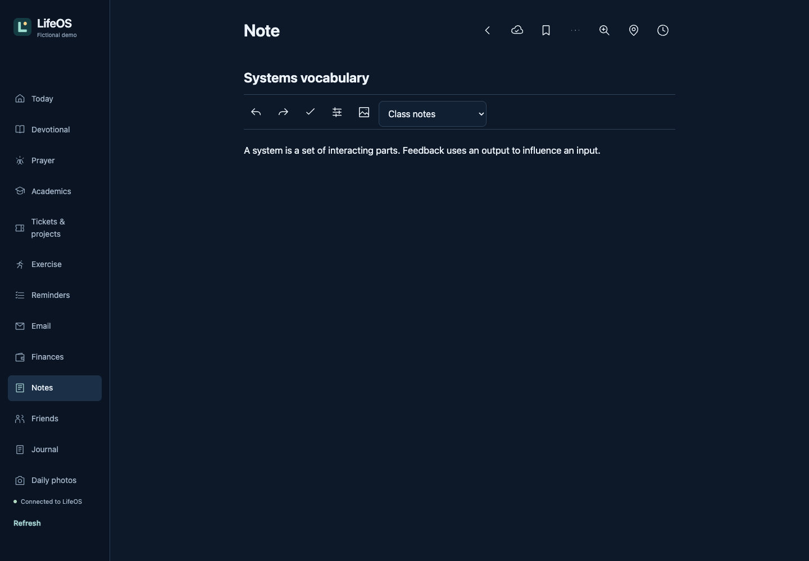

# LifeOS Open

LifeOS is a local personal workspace for planning a day, learning, reflecting and keeping everyday work together. This standalone edition retains the app's production screens and domain logic, with local SQLite persistence and an authored fictional workspace for **Alex Morgan**. No personal workspace or original git history is included.

https://github.com/user-attachments/assets/82e27767-006d-4d87-b299-e10be3057acf



## Quick start

Install **Node.js 24 or newer** with npm, then run from this directory:

```sh
npm ci
npm run dev
```

Open **http://127.0.0.1:8787**. The first launch creates `.local/workspace.sqlite` and seeds fictional courses, overlapping commitments, coursework, definitions, a lecture with timed ink/audio/slides, recipes, a budget, projects, journal entries and contacts such as Maya Chen. It needs no accounts or API keys. The sidebar identifies the demo and its mock services. Stop the server with **Ctrl-C**.

`npm install` followed by `npm run dev` also works without an `.env`. For a production build, run `npm run build` then `npm start`. A new workspace starts with a lab ten minutes away, a room, packing instructions, and a pre-lab deadline. For a reproducible morning demo, use the single optional flag `DEMO_CLOCK=2026-10-19T10:35:00Z npm run dev` with a new database. That clock advances while the server runs; it is not needed for normal use. To change the port, set `PORT` in an optional `.env` file copied from `.env.example`. Run all commands from the project root.

## Features

- Today: a live remaining-time countdown, local calendar event creation/editing/deletion, overlapping commitments that clear when moved, editable schedule entries, priority-sorted academic work with editable deadlines and difficulty, travel estimates, presence, work timers and planning tools.
- Academics: course and source references, assignment briefs, rich coursework, progress, co-op drafts, learning concepts and misconceptions, and an academic advisor.
- Lecture notebooks: pen and mouse ink, optional finger writing in Paper options, highlighter/eraser/lasso/graphs, undo/redo and pages, image/PDF sources, slide ranges and viewing, recording with permission, local audio recovery, tap timed ink to replay with a following transcript, context-aware lecture tutor, glossary, bookmarks and recall-ranked study cards. Click the middle of a slide to place that slide in the notebook. Use the save-status control then **Save notes now** to upload ink immediately; device saves are immediate and background uploads coalesce over 30 seconds. A fictional spoken recording and two slide pages are included.
- Notes: rich text, checklists, folders, pinning, attached images, revision conflict recovery and exports.
- Personal life: recipes and cooking steps/timers, groceries and recurring reminders, budget and categorisation, side projects with persistent steps and time blocks, exercise plans/run logs, and keep-in-touch schedules with a **Log contact** action.
- Reflection: daily photo upload/replacement and captions, journal templates with revision preview/restore, devotional responses and history, prayer lists, recording, transcript review and generic daily reflection placeholders.
- Support/settings: mock app support, account/presence devices, quota and service status, audit/revision history, deleted-item recovery, complete exports and verified local backups.
- Offline drafting: browser IndexedDB/localStorage retain unsent edits, ink, audio chunks and cooking/email work. SQLite persists server records across restarts. Network disconnection retains writing and queued schedule edits; reconnect to sync them. Journal and photo editors keep drafts on device; press Save to queue them before leaving. Reloading the entire app while offline is not supported; reconnect before reloading. API reads are not indiscriminately cached.
- Email: fictional sample messages and local draft composition/export. The original feature is a preview; sending mail is not implemented.

See [the screen and service inventory](docs/features.md) and [the route inventory](docs/feature-inventory.json) for coverage and boundaries.





## Configuration

`.env` is optional and ignored by git. `.env.example` contains placeholder names only.

| Setting | Default | Effect |
| --- | --- | --- |
| `PORT` | `8787` | Loopback listener |
| `AUTH_MODE` | `demo` | `demo`, token-protected `local`, or Google OAuth |
| `DEMO_SEED` | `true` | Seed only a new database; use `false` for an empty workspace |
| `LIFEOS_DATABASE` | `.local/workspace.sqlite` | Persistent local database |
| `LOCAL_ACCESS_TOKEN` | unset | Required for local mode, at least 24 random characters |
| `LLM_MODE` | `mock` | `real` enables the configured compatible chat API |
| `LLM_BASE_URL`, `LLM_API_KEY`, `LLM_MODEL` | unset | Required together for real AI; messages go to this endpoint |
| `GOOGLE_MODE` | `local` | `real` opts into Google file operations |
| `ALLOWED_EMAIL` | fictional demo identity | Configurable allowed OAuth/Drive owner |
| `GOOGLE_CLIENT_ID`, `GOOGLE_CLIENT_SECRET`, `GOOGLE_REFRESH_TOKEN` | unset | Operator-owned OAuth resources |
| `APP_ORIGIN` | loopback and chosen port | Must match the origin opened in the browser |
| `APP_CONFIG` | local resource map | JSON configuration for calendars, Drive folders and optional integration policy |
| `SCHOOL_HOME_URL`, `SCHOOL_CAREERS_URL`, `SCHOOL_OUTLINE_URL` | fictional HTTPS URLs | Hosts used consistently by retained school validators, prompts and link construction |
| `SCHOOL_ADDITIONAL_HOSTS` | unset | Comma-separated additional HTTPS source hostnames, with no credentials or paths |
| `LIFEOS_CLOUD_ORIGIN` | worker config `origin` | HTTPS origin for native AI/transcription workers; credential origin/component scope must match |
| `BETA_ORIGIN` | unset | Isolated beta destination for hosted production navigation and release links |

To create an empty private workspace, use a **new** database path with `AUTH_MODE=local`, `DEMO_SEED=false` and your own access token. Existing databases are never silently cleared or reseeded. Keep the token outside git. Demo mode is intended for local exploration.

AI answers, transcription, source refresh, contact extraction, cooking help, maintenance and release actions are explicitly **mocked** by default. Mock results are labelled scripted examples. The lecture tutor uses saved course notes, and the lab advisor uses saved schedule and coursework. They do not analyse recordings, handwriting or external course portals. Configured compatible chat requests include the same saved context. Recording bytes and handwritten timestamps save locally; the authored transcript belongs to the bundled sample recording. Real AI mode only changes assistant replies; it preserves the other local fallbacks. Files and records really save locally. Recording uses the browser's microphone APIs and needs browser permission. The demo recording was generated from authored fictional speech; its transcript is authored too. Local maintenance stores a report and never rewrites or deploys application code.

Optional real compatible AI and Google file/OAuth adapters are implemented, but were not exercised with live credentials during release preparation. Institution portal collection and native background workers are retained in `src/integrations` and `src/runtime` for configured deployments; a personal portal/account is never built into the standalone startup. Hosting, push delivery, managed D1 bindings and desktop workers require an operator-owned deployment. A complete local export includes private records, lecture/finance/study records and file bytes. Create a verified backup in Settings, download it, and restore only into a new database with:

```sh
npm run restore -- backup.json .local/restored.sqlite
```

Restoration checks database structure, file checksums and readback equality; it never overwrites an existing database. Authentication sessions and worker credentials are intentionally omitted. Start with LIFEOS_DATABASE set to the restored path.

For retained workers, export the same school settings in the worker process and deployment, or supply `schoolHomeUrl`, `schoolCareersUrl`, `schoolOutlineUrl` and `schoolAdditionalHosts` through its JSON configuration (`APP_CONFIG` for the hosted API). Invoke direct worker commands with Node’s `--env-file-if-exists=.env` option when using an env file. Maintenance uses two explicit `cloudConnections` mapped to its distinct `targets.beta` and `targets.production` origins. Those targets require separate credentials, databases, archive folders, job namespaces, deployment targets and data directories; configured alternate origins must also remain separate. No tenant hostname is built in. Worker recovery directories must be owned by the worker user and use canonical absolute paths without symlinks. Optional real deployment controllers require a reviewed base commit and operator-owned deployment configuration; the fresh public history intentionally has no commits.

The standalone workspace keeps cooking steps, timers and grocery reviews on this browser. Automatic school browsing and automatic code editing are unavailable with a chat-only provider; import materials and review code changes manually. Changing `ALLOWED_EMAIL` before first launch gives new fictional files that owner; changing an existing workspace identity requires an intentional data migration.

External service links are hidden unless their origins are explicitly configured with `GOOGLE_MODE=real` and `EXTERNAL_LINK_ORIGINS` (or the relevant school URL settings). Local source documents remain available. Desktop chat sends with Enter; Shift+Enter adds a line. On phones, use Send.

## Architecture

`public/` contains the original browser ESM UI and vendored editor, math, PDF and ink libraries. `src/domain/` holds deterministic planning rules. `src/cloud/` implements bounded, validated routes, optimistic versions, mutation receipts and audit history. `src/shared/` shares contracts between the UI, server and workers.

`src/local/` runs those routes on Node's SQLite API through a D1-shaped adapter. File operations use a local Drive-shaped transport stored in the same database; checksums and ownership checks remain active. Local jobs complete synchronously after a successful write, without background daemons. Real AI is an explicitly configured compatible chat endpoint shared by assistant and structured AI jobs. Set `LLM_MODEL` for the default and optionally `LLM_MODELS` for comma-separated extra choices. Demo mode offers only **Demo AI (offline)**. Compatible endpoints do not expose account quota, so usage UI stays hidden. `demo/scenarios.mjs` reuses authored portfolio fixtures; `src/local/workspace.ts` expands them and moves dates relative to first launch.

The browser retains drafts in its own origin. Use a fresh browser profile when exploring exported workspaces. No running personal app, port, browser storage or external account is required. Source `.lifeos` directories are never part of this project.

## Development and checks

```sh
npm run build
npm test
npm run lint
npm run typecheck
npm run privacy
npx playwright install chromium
npm run test:smoke
npm run test:e2e
```

The end-to-end suite uses isolated fictional databases and Chromium with fake microphone input, covers each of the 21 film features at 1440×900 and 390×844, and rejects browser errors or failed same-origin requests. It also checks configured AI against a loopback compatible stub, offline edits, invalid photo replacement, and navigation. It never uses a browser profile or a live provider. Screenshots, diagnostics and process ownership records go under `.runtime/e2e/` (override with `PARITY_DIR`). The suite runs without `.env` and owns its disposable loopback servers; all close in `finally`. It has no test retries.

TypeScript checks the new local adapters strictly; inherited JavaScript receives syntax/control-flow linting and functional tests. Browser smoke tests launch one isolated page and a disposable server on a free port, write evidence under ignored `.runtime/smoke/`, and close both in `finally`. They do not attach to a personal browser. Set `PLAYWRIGHT_BROWSERS_PATH` or `PLAYWRIGHT_EXECUTABLE_PATH` to reuse an installed test runtime.

Run a dedicated secret scanner such as `gitleaks dir . --redact` before publishing. The built-in privacy scan reports locations and finding types without values. Supply owner-specific scan regexes through LIFEOS_PRIVACY_PATTERNS, pointing to an external JSON array of pattern/flags objects; keep that file outside this repository. No owner-specific identities or encoded identifiers are embedded in the published scanner. Third-party attribution emails in vendor code/notices are reported separately for review. Screenshots in this README show only the generated fictional workspace.
## License

MIT, see LICENSE. Third-party components are listed in THIRD_PARTY_NOTICES.md.

