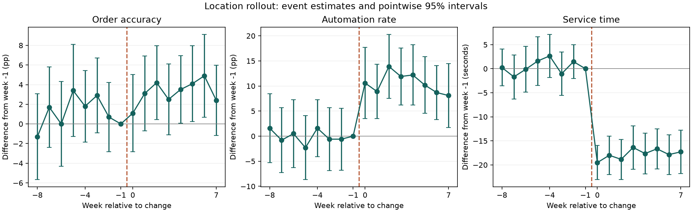

# Ordering change report

Synthetic demonstration; these are not restaurant measurements.

**Recommendation:** Try a limited, monitored rollout. All three outcomes improved in the analyzed designs. Confirm the result on real orders before a wider rollout.

Positive accuracy/automation changes and negative service-time changes are better. pp means percentage points: 90% to 93% is +3 pp.

## Randomized orders

| Outcome | Change | 95% interval | Adjusted p |
| --- | ---: | ---: | ---: |
| Order accuracy | +3.11 pp | +2.16 pp to +4.07 pp | 9.683e-10 |
| Automation rate | +9.72 pp | +8.02 pp to +11.47 pp | 6.173e-27 |
| Service time | -18.05 s | -18.53 s to -17.56 s | 0.0004998 |

Holm correction covers the three outcomes within this design. Intervals are pointwise 95%, not simultaneous intervals.

Orders: 6,010 control, 5,990 treatment. Accuracy plan: 1,796 per arm for 80% power to detect 90% to 93% accuracy, using a conservative three-outcome adjustment. This is a fixed plan, not observed power, and does not power every outcome.

Assignment checks (Holm-adjusted p; warning threshold 0.01):

- 50:50 sample ratio: 1
- pre-assignment item count: 0.8008
- location balance: 1

## Location before-and-after comparison

| Outcome | Change | 95% interval | Adjusted p |
| --- | ---: | ---: | ---: |
| Order accuracy | +2.07 pp | +0.61 pp to +3.54 pp | 0.006744 |
| Automation rate | +10.64 pp | +8.30 pp to +12.98 pp | 5.135e-11 |
| Service time | -18.16 s | -20.20 s to -16.12 s | 5.411e-20 |

Holm correction covers the three outcomes within this design. Intervals are pointwise 95%, not simultaneous intervals.

32,000 orders, 640 location-weeks; 40 location clusters. Equal weight per location-week; location and week effects remove fixed differences and shared weekly changes. Uncertainty allows orders at a location to move together.

Checks (Holm-adjusted p across all six checks; warning threshold 0.05):

- Order accuracy pre-trends: 1
- Order accuracy placebo: 1
- Automation rate pre-trends: 1
- Automation rate placebo: 1
- Service time pre-trends: 1
- Service time placebo: 1

The placebo pretends the change happened at week -4, using only pre-change data. Pre-trends jointly test all weeks before week -1.

## Limits

A quiet diagnostic cannot prove parallel trends or successful randomization. Location-specific events after rollout can still bias the comparison. The A/B calculation assumes independent orders with no repeat-customer or shared-queue effects. This is a single planned analysis, not a tool for repeatedly peeking until a result becomes significant.

Input SHA-256: `e4419b745b5c799c47dc6f4a2ca25524032cd81d52498df7e52c96662d711c90`. Analysis seed: 42. Full estimates and versions: [results.json](results.json).
