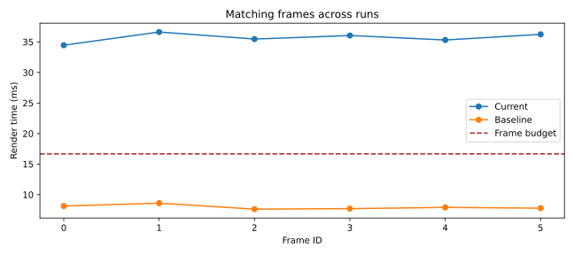

# Frame timing report

6 frames. Median 35.761 ms; p95 36.623 ms; maximum 36.623 ms.

Slow frames (render time > 16.67 ms): 0, 1, 2, 3, 4, 5.

Regression rule: increase > 10% AND > 1 ms.

## Regressions

- Frame 0: +26.326 ms (323.6%).
- Frame 1: +28.014 ms (325.4%).
- Frame 2: +27.842 ms (364.9%).
- Frame 3: +28.339 ms (367.5%).
- Frame 4: +27.407 ms (346.3%).
- Frame 5: +28.453 ms (365.3%).

## Frame details

| Frame | Build ms | Render ms | PNG ms | Total ms | Primary rays | Shadow rays | Primitive tests | Box tests |
| --- | --- | --- | --- | --- | --- | --- | --- | --- |
| 0 | 0.017 | 34.461 | 0.818 | 35.295 | 57600 | 38230 | 18495190 | 0 |
| 1 | 0.006 | 36.623 | 0.850 | 37.479 | 57600 | 38228 | 18494804 | 0 |
| 2 | 0.005 | 35.472 | 0.823 | 36.299 | 57600 | 38223 | 18493839 | 0 |
| 3 | 0.003 | 36.050 | 0.914 | 36.967 | 57600 | 38217 | 18492681 | 0 |
| 4 | 0.008 | 35.321 | 0.842 | 36.171 | 57600 | 38220 | 18493260 | 0 |
| 5 | 0.004 | 36.243 | 0.859 | 37.106 | 57600 | 38215 | 18492295 | 0 |

Only render_ms drives alerts. Build and PNG encoding are reported separately.
p95 uses the nearest rank. Timings depend on hardware and background load; use repeated Release runs.
